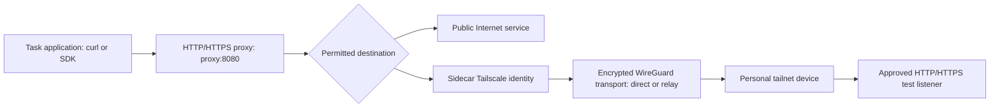

# Optional private development services through Tailscale

Issue: [#9](https://github.com/kcloud1/cloud-app-factory/issues/9).
Sources checked: 2026-10-11 (Asia/Singapore). This is a documentation guide;
no VPN connection, auth key, grant, service or deployment was created.

## Decision and default workflow

Use Tailscale only when an approved development task needs a private service.
Keep the proven default path independent of private networking:

```text
Web/mobile Codex Cloud → GitHub Issue/PR → reviewed main
                     → existing GitHub Actions → Cloudflare Worker
```

| Need | Connection | VPN required? |
| --- | --- | --- |
| Develop and release the existing public static app | Codex Cloud, GitHub, existing Actions/Cloudflare integration | No |
| Submit/list/inspect cloud tasks from a personal computer | Authenticated native `codex cloud` account API | No |
| Read a personal private test HTTP(S) API or package mirror | Optional environment Tailscale identity and permitted proxy destination | Yes, if reachable only through that tailnet |
| Attach a laptop shell to the cloud VM or synchronize files automatically | Not provided by this VPN integration | Unsupported |

Tailscale supplies connectivity, not application credentials, task control,
filesystem access, project authorization or automatic synchronization. A laptop
hosting the test service must stay awake and online while that service is needed.
A private service on an always-on personal server avoids that dependency. Neither
choice makes a laptop necessary for the default cloud-only pipeline.

## What happens at the connection level

The task executor and the networking sidecar are different components. In the
inspected managed runtime, the executor has no VPN interface or general direct
Internet route. The platform runs Tailscale in the sidecar. Do not install
`tailscaled`, change routes or unset proxies inside the executor to repair access.



These are four separate layers:

1. **Application:** `curl` makes a request to an explicit URL, for example
   `https://health.lab.example/health`. Scheme, hostname and port determine the
   service. The endpoint still needs its own authorization where applicable.
2. **Codex egress:** inherited `HTTP_PROXY`/`HTTPS_PROXY`, normally
   `http://proxy:8080`, carry requests through the platform's destination policy.
   Preserve the configured CA trust and TLS verification. Supported network
   secrets may be placeholders that this proxy substitutes only at approved
   destinations; they are not ordinary raw credentials.
3. **Tailnet:** the sidecar's enrolled identity connects to the permitted private
   destination. Tailnet grants/ACLs, route approval where needed, and the target
   firewall independently restrict access. A Codex allowlist alone is insufficient.
4. **Service:** the private machine must actually listen on the reachable address
   and port. An HTTP status and expected response establish service behavior;
   a connected VPN or open local port alone does not.

### Tailscale control plane versus encrypted data plane

Tailscale's coordination service distributes peer information, public keys and
policy. An **auth key enrolls nodes**; it is not the WireGuard private key and is
not an API password for the target service. Each enrolled node has its own keys.
Dedicated tags give task nodes a restricted machine identity instead of the
owner's ordinary user access. Review existing broad rules too: adding a narrow
grant does not cancel another rule that already permits broader access.

The **data plane** transports WireGuard-encrypted packets between nodes. Tailscale
tries direct peer connectivity using NAT traversal and UDP. Where that fails,
encrypted traffic can use DERP or a configured peer relay. Relays do not decrypt
the WireGuard payload. Direct paths generally have lower latency and better
throughput. This describes Tailscale's transport, not a measured connection path
for this Codex environment; its sidecar logs and VPN health are not exposed here.

The task's HTTP/TCP restrictions and the VPN's underlying transport are distinct:
the sidecar can transport an HTTP request over WireGuard while the executor still
cannot send arbitrary UDP/QUIC/ICMP or use `ping` as a VPN health test. Do not open
public firewall ports or add an exit node merely to make this guide work.

WireGuard encryption ends at the destination tailnet node. For a routed subnet
service, the subnet router decrypts before forwarding onto that LAN; HTTPS still
protects the application connection to the service. Plain HTTP has no independent
TLS layer. A listener, TLS certificate, host firewall and application authorization
remain necessary even inside the tailnet. A service bound only to `127.0.0.1`
on the personal machine is not automatically reachable from another node.
Windows/WSL/container port forwarding is a separate host concern; installing
Tailscale on Windows does not automatically publish a WSL localhost service.

### HTTP proxy and raw TCP CONNECT are different paths

| Path | Typical endpoint | Permission and credential behavior |
| --- | --- | --- |
| HTTP/HTTPS | `proxy:8080` via inherited proxy variables | HTTP destination rules and supported credential injection; preserve platform CA trust |
| Raw TCP | HTTP CONNECT at `proxy:8088` | Separate TCP grants plus VPN; opaque application bytes, no TLS interception or proxy credential injection |

For raw TCP, a forwarder would open a connection to `proxy:8088` and send an HTTP
`CONNECT destination:port` request. After a successful response it relays bytes
between the local client and that destination. It is not transparent routing or
a workaround for a denied HTTP destination. A listener becomes meaningful only
after a real client initiates CONNECT. Application TLS/authentication still runs
inside the tunnel, and proxy-secret placeholders cannot authenticate that client.

This runtime's TCP rules match exact domains/wildcards or literal IPv4 CIDRs;
hostname resolution must yield allowed private IPv4 ranges. Its current grants
cover all TCP ports, so use tailnet policy to restrict the service port. Changing
TCP grants needs a replacement environment with the new configuration version.
Forwarders must restart after task/environment restart; live processes are not
part of the reusable snapshot. This issue approves **no TCP pilot**, database,
SSH or forwarding-tool installation. Consult the active runtime's VPN guidance
if a separate future task explicitly authorizes one. Inbound connections to the
cloud node and Tailscale SSH/cloud VM attachment are unsupported by this integration.

## DNS: sources disagree; prove the selected runtime

| Source | Stated behavior |
| --- | --- |
| Tailscale Codex article retrieved for this guide | IPv4 and IPv4-resolving hosts; MagicDNS/split DNS unavailable |
| Current OpenAI environment docs retrieved for this guide | Private IPv4 subnet routes, MagicDNS and split DNS supported; internal FQDN must resolve to IPv4 |
| Active managed-runtime VPN reference | Sidecar resolves CONNECT names; `accept_dns=false`, MagicDNS/split tailnet DNS not configured |

Use current OpenAI docs for the product setup procedure, but do not promise a
particular runtime's DNS behavior without a request to the approved hostname.
Start the first authorized pilot with a known exact IPv4 or validated FQDN. DNS
resolution, routing and destination authorization are separate checks. Executor
DNS failure does not by itself disprove sidecar hostname resolution.

An IP-based HTTPS URL must have a certificate valid for that IP. Replacing a
hostname with an IP can break SNI/certificate identity. Do not use `curl -k` or
claim `--resolve` necessarily controls a remote proxy's DNS. Use a validated
FQDN with the intended certificate or an explicitly approved harmless HTTP
test endpoint; diagnose hostname failure separately. Never disable TLS checking.

## Owner guide: opt in only for one approved endpoint

The default owner action is **NONE**. Issue #9 does not authorize key issuance,
tailnet enrollment, network policy changes or service exposure. The following
steps describe a future separately approved personal-lab pilot.

1. Record one personal device, endpoint owner, exact address/hostname and port,
   `/health` path, harmless fictional response, visibility, budget and cleanup
   policy. Exclude real private files/data, writable APIs, corporate/Synapxe
   networks, AWS, production, SSH, SMB and databases. Creating or exposing the
   listener requires its own authorization. No tailnet enumeration or scans.
2. Prefer a separate optional **Only me** lab environment. Keep the published
   default factory/pilot environment VPN-disabled. Shared-environment tasks use
   the environment's configured VPN identity; they do not automatically use
   each task initiator's personal tailnet permissions.
3. Have the owner review a dedicated tag, for example `tag:codex-cloud-lab`,
   with access only to the safe target and port. Inspect overlapping allow rules,
   tag ownership and any applicable device approval requirements. For this
   direct-node pilot, do not introduce subnet routers, exit nodes or broad routes.
4. Only after approval, the owner generates a **tagged, Reusable, Ephemeral**
   auth key with an appropriately short expiry in Tailscale's Admin Console.
   Reusable supports enrollment of new task nodes; Ephemeral removes offline
   nodes automatically. Key expiry/revocation prevents further enrollment but
   is not a substitute for revoking access/removing already enrolled devices.
5. Enter the key directly in Codex Cloud environment **Advanced → VPN → Add →
   Tailscale** (labels may vary). Never put it in an Issue, PR, chat, source file,
   screenshot, init script, shell history or general task environment variable.
   Save only non-secret metadata in the pilot receipt.
6. Permit exactly the required destination through the supported Internet-access
   settings as well as tailnet policy. Preserve existing allowed hosts; HTTP
   permissions do not grant raw TCP access. Availability, workspace policy and
   VPN/CLI rollout can vary; check the actual account UI rather than assume.
7. Save, **Publish/Republish**, then start a new task and test. Saving a draft
   alone does not apply networking or publish it. Existing tasks are not proof
   of the new configuration. Do not install a Tailscale daemon in the executor.

Existing screenshots are referenced by the issue as showing **Tailscale Not set**;
no screenshot file was supplied to this task, so that image was not independently
inspected. The current non-secret runtime snapshot independently reports VPN off.
No paid features, plan change or cost consent are implied. Tailscale flow logs are
plan-dependent (the article identifies Premium/Enterprise); do not require them
for the default workflow or purchase them under this issue.

## Bounded validation and evidence

After separate endpoint/policy authorization, read the supported policy snapshot:

```sh
cat /etc/codex/network-policy.json
```

It contains policy, not credentials. `vpn_configured: true` is configuration,
not proof of a healthy VPN. Use the runtime `environment_status` tool for current
HTTP policy and binding readiness; it does not report TCP grants or VPN health.
Never dump the process environment or credential files. Do not edit the snapshot
to grant access.

For one approved HTTP(S) target only, substitute its real URL in this example:

```sh
curl --silent --show-error --fail-with-body \
  --connect-timeout 5 --max-time 20 \
  --write-out '\nHTTP %{http_code}\n' \
  https://health.lab.example/health
```

Keep inherited proxies/CA trust, omit `--noproxy`, and do not follow redirects to
unapproved hosts. Check curl's actual exit status, expected HTTP status and exact
fictional response. A successful request to GitHub or another service is not VPN
proof. Sanitize logs; verbose headers may expose service credentials.

**Negative control:** separately authorize one known harmless test destination
that the policy should deny. Have its owner confirm the listener is healthy and
reachable from an authorized control device. Request only that exact endpoint
from the cloud task. PASS requires an attributable policy denial, supported by
the proxy response or operator policy evidence. A timeout, DNS failure, closed
port or application 401/403 alone is **inconclusive**, not proof of isolation.
Do not test denial against real private data or choose an unrelated host by scanning.

| Failure | Next diagnostic action |
| --- | --- |
| VPN missing/false | Report setup gap; request owner configuration only for the separately authorized pilot |
| Proxy unreachable/sandbox error | Preserve proxies; retry the same bounded authorized request through the tool's normal approval flow if available; compare terminal versus agent path |
| Explicit destination denial | Request supported policy review; do not bypass proxy or broaden hosts |
| IP works, hostname fails | Diagnose sidecar DNS/FQDN/IPv4 and TLS identity; no disabled verification |
| Timeout | Operator checks target listener, host firewall, tailnet grant and any approved subnet route; not proof of denial |
| TLS verification failure | Check certificate hostname, chain and approved service CA; retain verification |
| Service 401/403 | Check application authorization; a service response is distinct from proxy-policy rejection |
| Raw TCP 503 `vpn_not_ready` / `vpn_policy_unavailable` | Operator sidecar investigation; configured VPN alone is insufficient |

Record a receipt without secrets or sensitive inventory:

```text
Issue/approval reference; UTC or timezone-qualified time:
Task/environment version; repository HEAD:
Scope: one approved fictional/read-only endpoint; owner; expiry/cleanup policy
VPN tag + key expiry metadata only (no key/device secrets):
Policy snapshot version; VPN flag; observed HTTP policy state:
Target/port/path (redact private identifiers in public evidence):
Execution path: normal inherited HTTP(S) proxy / approved escalation
Positive check: curl exit, HTTP status, expected sanitized response
Negative control: healthy target confirmed; attributable denial / INCONCLUSIVE
DNS check: exact-IP or FQDN result; no assumed MagicDNS success
Cleanup: VPN use stopped; setting removed/restricted and republished;
         enrollment key revoked/expired; enrolled devices/access reconciled
Default pipeline: existing evidence retained; any new regression check separately scoped
Outcome: PASS / FAIL / NOT_RUN; limitations and next owner action
```

When the pilot ends, stop requests/forwards, remove or restrict the VPN setting,
republish, revoke enrollment keys as appropriate, and verify removal of ephemeral
nodes/access in Tailscale. Do not remove existing Cloudflare secrets, change the
deploy writer or trigger a deployment just to test VPN cleanup.

## This task's validation receipt

- `VPN_NOT_CONFIGURED_BY_DESIGN`: snapshot version 1, VPN false; TCP domains
  and IP ranges empty. The 8088 address existing in a file proves no access.
- Runtime status reports running/connected, current observations, unrestricted
  desired HTTP policy with state **unknown**; enforcement and VPN health are
  not inferred from it. No private endpoint or denied-target request was made.
- `DOCS` and `CLI_VS_VPN`: source review and local CLI help checks completed;
  authenticated CLI listing returned 401. See the [CLI receipt](CODEX_CLI_CLOUD.md).
- M4's [existing receipt](https://github.com/kcloud1/cloud-app-factory/issues/4#issuecomment-6099912560)
  records actual cloud development, pilot PR #2, automatic release run
  `38068905425`, exact source SHA and HTTP release readback. PR #8 is merged.
  Issue #4 still reports OPEN despite the receipt's closure wording; this guide
  does not change that issue. No new deployment or browser suite was run.
- Application code, Actions workflows, deployment configuration and both
  repositories' existing public pipeline remain unchanged by this docs task.
- `NO_CREDENTIALS_OR_NETWORK_MUTATIONS=PASS`; owner action remains **NONE**.
  A live VPN pilot remains **NOT_RUN**, pending separate exact authorization.

## Sources and scope of claims

- [OpenAI cloud environments](https://learn.chatgpt.com/docs/environments/cloud-environments):
  VPN UI, reusable/ephemeral keys, publication, HTTP(S), current DNS claims.
- [Tailscale Codex article](https://tailscale.com/blog/codex-cloud-tailscale):
  tags, initial integration limits, CONNECT endpoint, optional flow logging.
- [How Tailscale works](https://tailscale.com/blog/how-tailscale-works) and
  [connection types](https://tailscale.com/docs/reference/connection-types):
  control/data plane, WireGuard, NAT traversal, direct/relay transport.
- [Auth-key handling](https://tailscale.com/docs/features/access-control/auth-keys/how-to/secure-auth-keys):
  reusable-key disclosure risks. Use the integrated VPN field here, not CLI key examples.
- Active Codex `cloud-environment:cloud-environment-runtime` skill,
  `references/networking.md` and `references/vpn.md`: executor/sidecar separation,
  proxies, TCP grants, DNS limitations and runtime diagnosis. These are runtime
  guidance available to an agent, not a claim that every account exposes TCP UI.
  Re-read them in the selected runtime before a future pilot.
